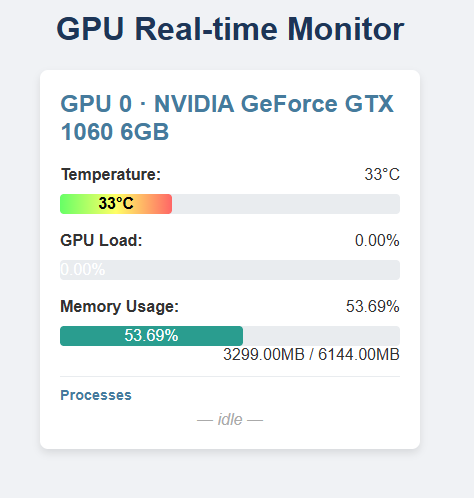

# GPU Real-time Monitor (FastAPI)

เว็บแอปแสดงสถานะการ์ดจอ NVIDIA แบบเรียลไทม์ สร้างด้วย FastAPI ไม่ต้อง build frontend แยก (ใช้ Jinja2 template + Tailwind จาก CDN)



## คุณสมบัติ
- แสดงข้อมูล GPU ทุกใบ: ชื่อ, อุณหภูมิ, % การใช้งาน, หน่วยความจำที่ใช้/ทั้งหมด
- **แสดง process ที่ใช้ GPU แต่ละใบ**: PID, ผู้ใช้ (user) ที่เป็นเจ้าของ, คำสั่ง (ตัดที่ 80 ตัวอักษร) และ VRAM ที่ใช้ เรียงจากใช้มากไปน้อย — เหมาะกับเครื่องที่มีหลายคนใช้ร่วมกัน
- อัปเดตอัตโนมัติทุก 2 วินาที (ดึงจาก `/api/gpu`)
- แถบสีแสดงระดับอุณหภูมิและการใช้งาน
- มี JSON API ให้ระบบอื่นเรียกใช้

---

## สิ่งที่ต้องมี
- Linux + การ์ดจอ NVIDIA พร้อมไดรเวอร์ และคำสั่ง `nvidia-smi`
- Python 3.8 ขึ้นไป
- รายการ process อ่านข้อมูลจาก `/proc` จึงใช้ได้บน Linux เท่านั้น (บนระบบอื่นหน้าเว็บยังแสดงข้อมูล GPU ได้ แต่รายการ process จะว่าง)

---

## ติดตั้ง

```bash
git clone https://github.com/doyze/GPU_monitor_no_frontend.git
cd GPU_monitor_no_frontend
python3 -m venv venv
source venv/bin/activate
pip install -r requirements.txt
```

## รัน

```bash
./run.sh
# หรือ
venv/bin/uvicorn app:app --host 0.0.0.0 --port 8007
```

เปิดเบราว์เซอร์ที่ `http://<ip-ของเครื่อง>:8007` กด `Ctrl + C` เพื่อหยุด

ระหว่างพัฒนาใส่ `--reload` เพิ่มได้ เพื่อให้เซิร์ฟเวอร์รีสตาร์ทเองเมื่อแก้โค้ด

### รันเป็น service ถาวร (systemd แบบ user)

สร้างไฟล์ `~/.config/systemd/user/gpu-monitor.service` (เปลี่ยน path ให้ตรงกับที่ clone ไว้):

```ini
[Unit]
Description=GPU Real-time Monitor (FastAPI :8007)
After=network-online.target

[Service]
WorkingDirectory=/path/to/GPU_monitor_no_frontend
ExecStart=/path/to/GPU_monitor_no_frontend/venv/bin/uvicorn app:app --host 0.0.0.0 --port 8007
Restart=always
RestartSec=3

[Install]
WantedBy=default.target
```

```bash
systemctl --user daemon-reload
systemctl --user enable --now gpu-monitor
systemctl --user status gpu-monitor
# ให้ service ทำงานต่อแม้ไม่ได้ login (ต้องใช้สิทธิ์ admin ครั้งเดียว)
sudo loginctl enable-linger $USER
```

---

## API

`GET /api/gpu` — คืนค่ารายการ GPU เป็น JSON

```json
[
  {
    "id": 0,
    "name": "NVIDIA RTX 4500 Ada Generation",
    "load_percent": "35.00",
    "load_raw": 35.0,
    "memory_used": "18230.00",
    "memory_total": "24570.00",
    "memory_util_percent": "74.20",
    "memory_util_raw": 74.2,
    "temperature": "61",
    "temperature_raw": 61.0,
    "processes": [
      {"pid": 12345, "user": "alice", "command": "python train.py --epochs 10", "memory_mb": 17800}
    ]
  }
]
```

ถ้าอ่านข้อมูล GPU ไม่ได้ จะคืน `[{"error": "<ข้อความ>"}]`

---

## โครงสร้างไฟล์

| ไฟล์ | หน้าที่ |
|---|---|
| `app.py` | แอปหลัก: route `/` (หน้าเว็บ) และ `/api/gpu` (JSON) รวมการดึงรายการ process |
| `templates/index.html` | หน้าเว็บ (Tailwind CDN) ดึง `/api/gpu` ทุก 2 วินาที |
| `run.sh` | สคริปต์รันด้วย venv ที่พอร์ต 8007 |
| `main.py` | เวอร์ชันเดิมแบบไฟล์เดียว (ฝัง HTML ในไฟล์, ไม่มีรายการ process, บังคับให้รันใน venv) เก็บไว้อ้างอิง — ใช้งานจริงให้รัน `app.py` |
| `requirements.txt` | fastapi, uvicorn[standard], Jinja2, GPUtil |
| `docs/screenshot.png` | ภาพหน้าจอสำหรับ README |

---

## ข้อควรระวัง
- แอปนี้ไม่มีระบบ login และรัน `--host 0.0.0.0` ทุกคนที่เข้าถึงพอร์ตได้จะเห็นชื่อผู้ใช้และคำสั่งของ process บน GPU — ควรเปิดเฉพาะในเครือข่ายภายใน หรือกั้นด้วย firewall/reverse proxy
- ผู้ใช้ที่รันแอปต้องเรียก `nvidia-smi` ได้ และอ่าน `/proc/<pid>` ของ process อื่นได้ (ค่าปกติของ Linux ส่วนใหญ่อนุญาต)
